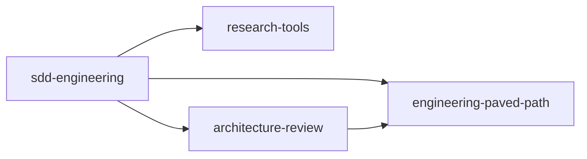

# dev-team-ai-engineering-marketplace

A [Claude Code plugin marketplace](https://code.claude.com/docs/en/plugins/create-marketplace) for the dev team: shared skills, agents and workflows for AI-assisted engineering.

## Plugins

| Plugin | Description | Depends on | Version |
|---|---|---|---|
| [architecture-review](plugins/architecture-review) | Read-only architecture boundary review agent | engineering-paved-path | 1.0.0 |
| [dev-workflow](plugins/dev-workflow) | Conventional Commits messages and a read-only code reviewer agent | — | 0.1.0 |
| [engineering-paved-path](plugins/engineering-paved-path) | Shared React, Next.js, Fastify, architecture, testing and security skills | — | 1.0.0 |
| [research-tools](plugins/research-tools) | Read-only researcher agent for codebase and external questions | — | 1.0.0 |
| [sdd-engineering](plugins/sdd-engineering) | Spec Driven Development: spec → plan → build → verify through a chain of agents | architecture-review, engineering-paved-path, research-tools | 1.0.0 |

Dependencies are installed and enabled automatically: `claude plugin install sdd-engineering@dev-team-ai-engineering-marketplace` brings in the other three.



## Installation

Requires Claude Code **2.1.300** or newer (`claude --version`).

### For yourself

```bash
claude plugin marketplace add dmitrii1600/dev-team-ai-engineering-marketplace
claude plugin install dev-workflow@dev-team-ai-engineering-marketplace
```

The same works inside a session: `/plugin marketplace add ...` and `/plugin install ...`.

### For the whole team in a project repository

Commit `.claude/settings.json` to the project repository:

```json
{
  "extraKnownMarketplaces": {
    "dev-team-ai-engineering-marketplace": {
      "source": { "source": "github", "repo": "dmitrii1600/dev-team-ai-engineering-marketplace" }
    }
  },
  "enabledPlugins": {
    "dev-workflow@dev-team-ai-engineering-marketplace": true
  }
}
```

Once a teammate accepts the folder trust dialog, Claude Code adds the marketplace and offers the plugins. To turn a plugin off just for yourself, set `"dev-workflow@dev-team-ai-engineering-marketplace": false` in `.claude/settings.local.json`.

### Updates

Auto-update is **off by default** for third-party marketplaces. Turn it on in `/plugin` → Marketplaces → `dev-team-ai-engineering-marketplace` → Enable auto-update, or update manually:

```bash
claude plugin marketplace update dev-team-ai-engineering-marketplace
claude plugin update dev-workflow@dev-team-ai-engineering-marketplace
```

A running session keeps the old version until `/reload-plugins` or a restart.

## Private repository access

`marketplace.json` has no token field: Claude Code uses your git with interactive prompts disabled. Set up credentials beforehand:

```bash
gh auth login
gh auth setup-git
```

Without a GitHub SSH key, set `CLAUDE_CODE_PLUGIN_PREFER_HTTPS=1`. A `GITHUB_TOKEN` environment variable alone does not work for background auto-update.

## Layout

```
.claude-plugin/marketplace.json   plugin catalog
plugins/<name>/                   one directory per plugin
  .claude-plugin/plugin.json      manifest (name, version, ...)
  skills/<skill>/SKILL.md
  agents/*.md
  hooks/hooks.json, .mcp.json     (when needed)
  evals/                          eval cases and fixtures (when present)
  README.md, CHANGELOG.md
evals/                            shared eval harness for plugin skills and agents (not shipped)
.github/                          CI, CODEOWNERS, PR template
docs/specs/                       specifications
```

## Contributing

See [CONTRIBUTING.md](CONTRIBUTING.md) for how to add or change a plugin.
