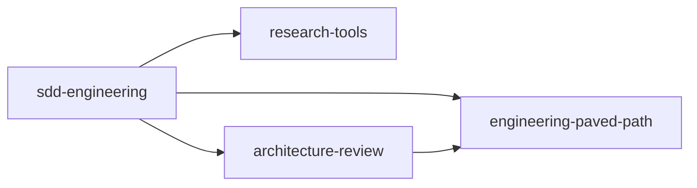

# Specification: SDD Engineering and its dependency plugins

| | |
|---|---|
| Status | Draft |
| Author | Dmytro Shevchenko |
| Date | 2026-10-15 |
| Source | [`dmitrii1600/dev-digest`](https://github.com/dmitrii1600/dev-digest), `.claude/agents/`, `.claude/skills/`, `scripts/`, `evals/` |
| Docs checked | [Plugin dependencies](https://code.claude.com/docs/en/plugins/dependencies), [Manifest reference](https://code.claude.com/docs/en/plugins/manifest-reference), [Plugin components](https://code.claude.com/docs/en/plugins/components), [Subagents](https://code.claude.com/docs/en/sub-agents), [Skills](https://code.claude.com/docs/en/skills) (fetched 2026-10-15) |

## 1. Goal

Move the Spec Driven Development (SDD) chain out of DevDigest and release it from this
marketplace as one product plugin, `sdd-engineering`, plus three reusable plugins it
depends on. Any project should be able to install `sdd-engineering` and run
spec → plan → build → verify → review without DevDigest paths, scripts or conventions.

### Non-goals

- Porting DevDigest product specs, plans, retro ledger entries or `INSIGHTS.md` content.
- Porting `test-writer`, `doc-writer`, `architecture-reviewer-lite`, `pr-self-review`
  (and its `PreToolUse` gate hook), `engineering-insights`, `dependency-checker`. See [§9](#9-later).
- A merge gate. In 1.0 every review agent stays advisory.

## 2. Plugins and dependency graph

| Plugin | Role | Provides | Depends on |
|---|---|---|---|
| `engineering-paved-path` | reusable | React, Next.js, Fastify, architecture, testing and security skills + `skill-routing` | — |
| `research-tools` | reusable | read-only agent `researcher` | — |
| `architecture-review` | reusable | generalized agent `architecture-reviewer` | `engineering-paved-path` `^1.0.0` |
| `sdd-engineering` | product | 4 agents, `run-plan`, `workflow-retro`, `spec-writing`, evals, docs | all three, `^1.0.0` |



**D-1. `architecture-review` → `engineering-paved-path` is a declared dependency.** The
reviewer's rulebook *is* `onion-architecture` and `frontend-ui-architecture`; without them
it restates generic advice. The edge adds no install cost for `sdd-engineering` users,
who get `engineering-paved-path` anyway.

## 3. Component inventory

What comes from where. "Generalize" means: strip DevDigest paths, package names and
commands, and replace them with the inputs from [§5](#5-project-inputs-replacing-devdigest-paths).

### 3.1 `engineering-paved-path`

| Skill | Source | Change |
|---|---|---|
| `react-best-practices` | `.claude/skills/react-best-practices` | as is |
| `next-best-practices` | `.claude/skills/next-best-practices` | as is |
| `frontend-ui-architecture` | `.claude/skills/frontend-ui-architecture` | drop `references/devdigest-client.md`; `client/src/...` paths become "the frontend app root" |
| `fastify-best-practices` | `.claude/skills/fastify-best-practices` | drop `tile.json` |
| `onion-architecture` | `.claude/skills/onion-architecture` | generalize: rings and rules stay, `server/src/...`, `pnpm arch` and DevDigest module names go |
| `react-testing-library` | `.claude/skills/react-testing-library` | as is (603 lines → move detail into `references/` to fit the 500-line limit) |
| `security` | `.claude/skills/security` | as is; review-time only |
| `skill-routing` | **new**, from `pr-self-review/routing.md` | generic file-group → skill table with the *write-time vs review-time* split, no DevDigest globs; a project overrides it through `routing` ([§5](#5-project-inputs-replacing-devdigest-paths)) |

`skill-routing` replaces the one DevDigest table that the planner, the implementer and
the reviewer all read. It is a skill, not a file, because another plugin's files cannot
be addressed by path; a skill can be loaded by name.

### 3.2 `research-tools`

| Agent | Source | Change |
|---|---|---|
| `researcher` | `.claude/agents/researcher.md` | remove `AGENTS.md` / `INSIGHTS.md` / `/deep-research` references; read the project's conventions files from the inputs instead |

### 3.3 `architecture-review`

| Component | Source | Change |
|---|---|---|
| agent `architecture-reviewer` | `.claude/agents/architecture-reviewer.md` | `skills:` → `engineering-paved-path:onion-architecture`, `engineering-paved-path:frontend-ui-architecture`; static rule names (`engine-purity`, `do-not-touch`, `migration-edited` ...) and `scripts/verify.mjs server --checks` replaced by the project's `verify.checks` command; scope rules (`server/`, `client/`, `reviewer-core/`, `@devdigest/shared`) become "the layers the loaded skills define" |
| `evals/` | `evals/agents/architecture-reviewer/` (cases + 3 fixtures) | fixtures rewritten without DevDigest package names |

### 3.4 `sdd-engineering`

| Component | Source | Change |
|---|---|---|
| agent `spec-creator` | `.claude/agents/spec-creator.md` | five spec folders → `specsDir`; `Agent` limited to `research-tools:researcher`; lint via the `spec-writing` script |
| agent `implementation-planner` | `.claude/agents/implementation-planner.md` | `plans/` → `plansDir`; skill contract derived from `engineering-paved-path:skill-routing` (or the project `routing`); `scripts/verify.mjs` → `verify` commands |
| agent `implementer` | `.claude/agents/implementer.md` | loads skills by namespaced name (`engineering-paved-path:react-best-practices`); verifies with the plan's commands only |
| agent `plan-verifier` | `.claude/agents/plan-verifier.md` | `report to:` path under `runsDir`; re-runs the plan's verify commands |
| skill `spec-writing` | `.claude/skills/spec-writing` | spec template and lifecycle from `specs/README.md` move into `references/`; `scripts/spec-lint.mjs` ships inside the skill |
| skill `run-plan` | `.claude/skills/run-plan` | see [§6](#6-run-plan-in-10) |
| skill `workflow-retro` | `.claude/skills/workflow-retro` | `scripts/retro-usage.mjs` ships inside the skill; ledger folder → `retroDir`; stays `disable-model-invocation: true` |
| `evals/` | new | cases for the four agents and `run-plan` (DevDigest has none for them) |
| `README.md`, `CHANGELOG.md`, `docs/` | `.claude/agents/README.md`, `specs/README.md`, `plans/README.md`, `docs/retro/README.md` | rewritten for a generic project, see [§7](#7-documentation) |

`spec-writing` is not on the release slide but is required: `spec-creator` preloads it and
the planner and verifier read its identifier scheme. It is internal to `sdd-engineering`.

## 4. Layout

```
plugins/
  engineering-paved-path/
    .claude-plugin/plugin.json
    skills/{react-best-practices,next-best-practices,frontend-ui-architecture,
            fastify-best-practices,onion-architecture,react-testing-library,
            security,skill-routing}/SKILL.md (+ references/)
    README.md  CHANGELOG.md
  research-tools/
    .claude-plugin/plugin.json
    agents/researcher.md
    README.md  CHANGELOG.md
  architecture-review/
    .claude-plugin/plugin.json          dependencies: engineering-paved-path ^1.0.0
    agents/architecture-reviewer.md
    evals/architecture-reviewer/{*.cases.ts, fixtures/}
    README.md  CHANGELOG.md
  sdd-engineering/
    .claude-plugin/plugin.json          dependencies: the three above, ^1.0.0
    agents/{spec-creator,implementation-planner,implementer,plan-verifier}.md
    skills/
      spec-writing/   SKILL.md  references/{spec-template,lifecycle}.md  scripts/spec-lint.mjs
      run-plan/       SKILL.md  references/plan-format.md
      workflow-retro/ SKILL.md  references/ledger-template.md  scripts/retro-usage.mjs
    evals/{spec-creator,implementation-planner,implementer,plan-verifier,run-plan}/
    docs/{configuration,artifacts}.md
    README.md  CHANGELOG.md
evals/                                  shared eval harness (from dev-digest evals/src), not in any plugin
```

### Naming and paths

- **Skills of another plugin** are called by namespace: `engineering-paved-path:react-best-practices`.
  Never by path.
- **Agents of another plugin** are dispatched by scoped name: `research-tools:researcher`,
  `architecture-review:architecture-reviewer`, `sdd-engineering:implementer`.
- **Supporting scripts** are referenced from the skill body as
  `node "${CLAUDE_SKILL_DIR}/scripts/spec-lint.mjs"`, never `.claude/skills/...`.
  `${CLAUDE_PLUGIN_ROOT}` changes with every version and only points into the plugin's own
  directory, so nothing outside the plugin is reachable through it.
- **State** (run reports) lives in the project (`runsDir`), never in the plugin directory.
- Plugin agents ignore `hooks`, `mcpServers` and `permissionMode` frontmatter; none of
  the ported agents may rely on them.

### `sdd-engineering/.claude-plugin/plugin.json`

```json
{
  "$schema": "https://json.schemastore.org/claude-code-plugin-manifest.json",
  "name": "sdd-engineering",
  "displayName": "SDD Engineering",
  "version": "1.0.0",
  "description": "Spec Driven Development: spec, plan, build and verify through a chain of agents.",
  "author": { "name": "Dmytro Shevchenko", "url": "https://github.com/dmitrii1600" },
  "dependencies": [
    { "name": "engineering-paved-path", "version": "^1.0.0" },
    { "name": "research-tools", "version": "^1.0.0" },
    { "name": "architecture-review", "version": "^1.0.0" }
  ]
}
```

Bare names resolve in this marketplace, so no cross-marketplace allowlist is needed.
Dependencies are installed and enabled automatically with `sdd-engineering`.

## 5. Project inputs (replacing DevDigest paths)

Every DevDigest path becomes an explicit input. Defaults cover a project with no config;
`.claude/sdd-engineering.json` in the project overrides them. `run-plan` resolves the
values once and passes them to each agent **in the prompt**, so an agent never guesses a path.

| Input | Default | Replaces in DevDigest |
|---|---|---|
| `specsDir` | `specs/` | the five spec folders |
| `plansDir` | `plans/` | `plans/` |
| `runsDir` | `.sdd/runs/` (git-ignored by the user) | `.devdigest/sdd/<stem>/` |
| `retroDir` | `docs/retro/` | `docs/retro/` |
| `conventions` | `["AGENTS.md", "CLAUDE.md"]` that exist | five `AGENTS.md` files |
| `insights` | `null` (read `INSIGHTS.md` only when set) | `INSIGHTS.md` + `/engineering-insights` |
| `verify.checks` | none — the planner asks | `scripts/verify.mjs <pkg> --checks` |
| `verify.tests` | none — the planner asks | `scripts/verify.mjs <pkg> --tests / --file` |
| `gate` | `null` (no gate phase) | `/pr-self-review` |
| `routing` | `engineering-paved-path:skill-routing` | `pr-self-review/routing.md` |

```json
{
  "specsDir": "docs/specs",
  "verify": { "checks": "pnpm lint && pnpm typecheck", "tests": "pnpm vitest run {file}" },
  "gate": "/dev-workflow:code-review"
}
```

When `verify` is missing, the planner returns it as a question in its *Requirements
review*, the same channel it already uses for the execution mode.

## 5a. Portability rules

Every plugin here is public and not tied to one project. These rules apply to **skills,
agents, scripts, READMEs, CHANGELOGs and evals alike**:

- No name of the source project, its packages, modules, scopes or repository URL.
- No hard-coded project paths (`server/src/...`, `client/src/...`, a fixed list of spec
  folders, `.devdigest/...`, `scripts/verify.mjs`). Paths come from the inputs in [§5](#5-project-inputs-replacing-devdigest-paths)
  or are described by role ("the backend source root").
- No dated "we changed this on ..." history or links to the source project's retro
  ledger or insights files; keep the rule, drop the anecdote.
- Examples use a neutral sample domain (orders, invoices, a todo app).
- Scripts are referenced through `${CLAUDE_SKILL_DIR}`, never `.claude/skills/...`.
- Check: `grep -rniE "devdigest|dev-digest|reviewer-core|\.devdigest|scripts/verify\.mjs|\.claude/skills/|\.claude/agents/" plugins/` returns nothing.

## 6. `run-plan` in 1.0

The phase order stays: **build → verify (fix loop ≤ 2) → arch (fix loop ≤ 2) → delta → gate**.
Hard rules stay (paths not retellings, save first, hard caps, thin context, no PR).

| DevDigest behaviour | 1.0 |
|---|---|
| reports in `.devdigest/sdd/<stem>/` | `<runsDir>/<stem>/`, same numbering (`10-build.md`, `20-verify-1.md` ...) |
| `--with-tests` → `test-writer` | removed (agent not ported) |
| `--docs` → `doc-writer` | removed (agent not ported) |
| `/engineering-insights` phase | removed; agents still *read* `insights` when set |
| `/pr-self-review` gate | runs `gate` when set; otherwise the run ends after delta with a summary |
| `scripts/verify.mjs` cache in `.devdigest/verify/` | none; agents run the plan's own verify commands. Cost note in the README |
| dispatch `implementer`, `plan-verifier` | `sdd-engineering:implementer`, `sdd-engineering:plan-verifier` |
| dispatch `architecture-reviewer` | `architecture-review:architecture-reviewer` |

Argument hint: `<plansDir/stem.md> [--from build|verify|arch|delta|gate]`.

## 7. Documentation

### Every plugin's `README.md`

Each of the four plugins ships a README that a newcomer can work from without opening the
component files: what the plugin is for, install command (dependencies come with it),
a components table (type, namespaced name, how to invoke), a usage section per component
with a short example, configuration (if any), what it depends on and who depends on it,
limits ("never does"), and a link to `CHANGELOG.md`. The source project's own READMEs
(`.claude/agents/README.md`, `.claude/skills/README.md`, skill-level READMEs,
`specs/README.md`, `plans/README.md`, `docs/retro/README.md`) are the starting point,
rewritten under [§5a](#5a-portability-rules).

### `sdd-engineering/README.md` (required sections)

1. **What it is** — the chain in one diagram: `spec-creator` → person approves →
   `implementation-planner` → `/run-plan` (`implementer` → `plan-verifier` →
   `architecture-reviewer` → delta → gate) → `/workflow-retro`.
2. **Install** — one command; dependencies come with it.
3. **Quick start** — the three manual steps (spec, approve, plan) and one `/run-plan`.
4. **How the pieces fit** — the agent catalog table (model, tools, input, output, never),
   which plugin each agent and skill comes from, how skills reach a subagent
   (`skills:` preload vs `Skill` on demand, write-time vs review-time).
5. **Artifacts** — spec, plan and run-report formats, file naming, `Status` lifecycle.
6. **Configuration** — the [§5](#5-project-inputs-replacing-devdigest-paths) table and an example.
7. **Permissions** — what each agent may write, enforced by `tools:` vs by prompt text only.
8. **Cost** — opus for spec and plan, sonnet for the rest; no verify cache in 1.0.
9. **Retro** — when and how to run `/workflow-retro`.

### `CHANGELOG.md` (the versions and releases file)

Every plugin keeps one, in the repo's Keep a Changelog format. `sdd-engineering`'s
changelog also states, per release, the dependency ranges it was released against:

```markdown
## [1.0.0] - 2026-10-xx
### Added
- Agents spec-creator, implementation-planner, implementer, plan-verifier.
- Skills run-plan, workflow-retro, spec-writing.
### Dependencies
- engineering-paved-path ^1.0.0, research-tools ^1.0.0, architecture-review ^1.0.0
```

## 8. Versions, registration and release

- **All four start at `1.0.0`**, not the repo's usual `0.1.0`: the dependency range is
  `^1.0.0`, and `^0.x` would lock consumers to one minor version.
- Breaking change in a dependency (a skill renamed or removed, an agent's report format
  changed) = major bump there **and** a widened range in `sdd-engineering`.
- **Registration**: four entries in `.claude-plugin/marketplace.json`, sorted by name
  (`architecture-review`, `dev-workflow`, `engineering-paved-path`, `research-tools`,
  `sdd-engineering`), each with its own `name`, `source`, `description`, `category`, `tags`.
  Version and owner live in `plugin.json` (`version`, `author`); CODEOWNERS gets a line per plugin.
- **Tags**: dependency ranges are resolved against `<name>--v<version>` git tags, so
  dependencies are tagged first. Release order:
  1. `engineering-paved-path`, `research-tools` → `claude plugin tag plugins/<name> --push`
  2. `architecture-review`
  3. `sdd-engineering`
- **Catalog state**: a commit on `main` (or a marketplace tag) fixes the catalog; a team
  that needs a frozen set pins that ref in its marketplace source.

### CI changes

- `check-marketplace.mjs`: every `dependencies` name exists in `marketplace.json`; no
  cycles; each range is satisfied by the dependency's current `plugin.json` version.
- `check-version-bump.mjs`: changes only under `plugins/*/evals/` do not require a bump.
- CODEOWNERS review for `plugins/*/skills/*/scripts/` (scripts run with user privileges).

## 9. Not moved

| Category | Examples in DevDigest |
|---|---|
| Product specs | `specs/*.md`, `<pkg>/specs/*.md`, `specs/designs/`, `plans/*.md`, `docs/retro/ledger/*` |
| Secrets | `.devdigest/secrets.json`, anything under `.env*` |
| Cache | `.devdigest/verify/`, `.devdigest/pr-self-review/`, `.devdigest/sdd/` |
| DevDigest-specific instructions | `AGENTS.md`, `CLAUDE.md`, `INSIGHTS.md` content; `routing.md` package globs; static rules (`engine-purity`, `do-not-touch`, `migration-edited`, `claude-md-stub` ...); the `pr-self-review-gate.mjs` hook; `scripts/verify.mjs`, `dev.sh`, `e2e.sh` |

### Later

- `test-writer`, `doc-writer` → `sdd-engineering` 1.x (brings back `--with-tests`, `--docs`).
- `engineering-insights`, `mermaid-diagram` → a small shared plugin.
- `typescript-expert`, `zod`, `drizzle-orm-patterns`, `postgresql-table-design` → `engineering-paved-path` 1.x.
- A generic `pr-self-review` gate with its hook.

## 10. Verified behaviour (formerly open questions)

Not covered by the docs on 2026-10-15, so checked with two throwaway plugins and
`claude -p --plugin-dir` on Claude Code 2.1.300:

| # | Question | Result |
|---|---|---|
| Q-1 | Does an agent's `skills:` preload accept a skill from another plugin? | **Yes, only by namespaced name** (`engineering-paved-path:onion-architecture`). A bare name (`onion-architecture`) is silently not loaded |
| Q-2 | Does the `Agent` tool accept a scoped `subagent_type` from another plugin? | **Yes** (`architecture-review:architecture-reviewer`) |
| Q-3 | Is `${CLAUDE_SKILL_DIR}` substituted in a skill preloaded into an agent? | **Yes**, it resolves to the skill's own directory inside the other plugin |
| Q-4 | Minimum Claude Code version for `dependencies` | Works on 2.1.300 (the version CI pins); confirmed by the install smoke test |

Consequence: every reference to a skill or agent of **another** plugin is written with
its namespace, everywhere (frontmatter, bodies, READMEs). References inside the same
plugin also use the namespace, so a rename never has two spellings.

## 11. Done when

- `claude plugin validate plugins/<name> --strict` passes for all four; `check-marketplace.mjs` passes.
- `claude plugin install sdd-engineering@dev-team-ai-engineering-marketplace` on a clean
  machine installs and enables all four plugins.
- `grep -ri "devdigest\|\.devdigest\|scripts/verify.mjs\|\.claude/skills/" plugins/` returns nothing.
- In a sample project with no `.claude/sdd-engineering.json`, the full chain runs:
  a spec in `specs/`, a plan in `plans/`, `/run-plan` writes reports to `.sdd/runs/<stem>/`
  and ends with a summary.
- The [§5a](#5a-portability-rules) grep returns nothing.
- The root `README.md` plugin table, `CONTRIBUTING.md` and `CODEOWNERS` list the new plugins.
