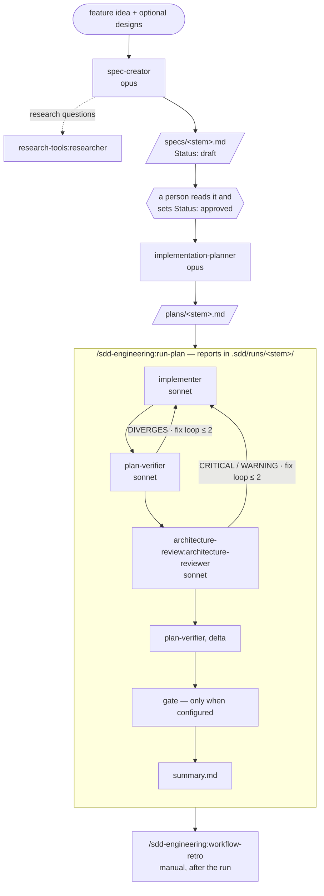

# sdd-engineering

Spec Driven Development for Claude Code: a chain of agents that turns a feature idea into
an approved spec, the spec into an executable plan, and the plan into code that is
checked item by item against what was agreed — with a person approving at the two points
where a decision is made.

## 1. What it is



- **The spec** says *what* and *why*: problem and user, EARS acceptance criteria, edge
  cases, a design review, non-functional requirements, traceability, untrusted inputs.
- **The plan** says *how*: numbered steps with files, layers, the skills to load, an
  observable *done when* and a verify command each — single-agent or as parallel tracks.
- **run-plan** builds the plan, verifies it, reviews the architecture, closes the gaps in
  capped fix loops and stops with a summary. It never opens a pull request.
- **workflow-retro** measures how the run went and proposes changes to the chain.

## 2. Install

```bash
claude plugin install sdd-engineering@dev-team-ai-engineering-marketplace
```

Its three dependencies — `engineering-paved-path`, `research-tools` and
`architecture-review` — are installed and enabled with it. Requires Node 22 or newer for
the two bundled scripts.

## 3. Quick start

In a project with no configuration (specs go to `specs/`, plans to `plans/`):

1. **Spec.** Ask for one:
   > Use the sdd-engineering:spec-creator agent to spec "download an invoice as PDF".

   It may come back with *Need clarification* questions or research questions first;
   answer them and it writes `specs/2026-10-15-export-invoice-pdf.md` with
   `Status: draft`.
2. **Approve.** Read the draft. Edit what is wrong, then change the line to
   `Status: approved` yourself — no agent ever does.
3. **Plan.**
   > Use the sdd-engineering:implementation-planner agent on specs/2026-10-15-export-invoice-pdf.md.

   The first answer is usually a *Requirements review*: a ledger of the requirements,
   questions, recommendations, the verify commands it needs and single-agent or
   multi-agent. Answer, and it writes `plans/2026-10-15-export-invoice-pdf.md`.
4. **Build.**
   ```
   /sdd-engineering:run-plan plans/2026-10-15-export-invoice-pdf.md
   ```
   Reports land in `.sdd/runs/2026-10-15-export-invoice-pdf/`; the run ends with
   `summary.md` and a short list of what needs you.

Add `.sdd/` to `.gitignore` before the first run.

## 4. How the pieces fit

### Components

| Type | Namespaced name | From plugin | How to invoke |
|---|---|---|---|
| Agent | `sdd-engineering:spec-creator` | sdd-engineering | "use the sdd-engineering:spec-creator agent to spec …" or `@sdd-engineering:spec-creator` |
| Agent | `sdd-engineering:implementation-planner` | sdd-engineering | "plan specs/<stem>.md with sdd-engineering:implementation-planner" |
| Agent | `sdd-engineering:implementer` | sdd-engineering | dispatched by run-plan; by hand: "implement plans/<stem>.md with sdd-engineering:implementer" |
| Agent | `sdd-engineering:plan-verifier` | sdd-engineering | dispatched by run-plan; by hand: "check this branch against plans/<stem>.md with sdd-engineering:plan-verifier" |
| Skill | `sdd-engineering:run-plan` | sdd-engineering | `/sdd-engineering:run-plan <plansDir>/<stem>.md [--from build\|verify\|arch\|delta\|gate]` |
| Skill | `sdd-engineering:workflow-retro` | sdd-engineering | `/sdd-engineering:workflow-retro [--deep] [--stem <stem>]` — manual only |
| Skill | `sdd-engineering:spec-writing` | sdd-engineering | internal: preloaded into spec-creator, loaded by the planner and verifier |
| Agent | `research-tools:researcher` | research-tools | called by spec-creator for research questions |
| Agent | `architecture-review:architecture-reviewer` | architecture-review | dispatched by run-plan in the arch phase |
| Skill | `engineering-paved-path:skill-routing` | engineering-paved-path | the file-group → skill table the planner, implementer and reviewer share |
| Skills | `engineering-paved-path:*` (react, next, fastify, onion and frontend architecture, testing, security) | engineering-paved-path | loaded by the implementer from the plan's *Skill contract*, by the reviewer as its rulebook |

### Agent catalog

| Agent | Model | Tools | Input | Output | Never |
|---|---|---|---|---|---|
| `spec-creator` | opus | Read, Write, Edit, Grep, Glob, Bash, Skill, Agent (→ `research-tools:researcher` only) | a feature idea + optional design paths; on a second round, the answers and research reports | `<specsDir>/<stem>.md` (`Status: draft`, lint-clean) + *Spec Report* — or a *Need clarification* / *Research needed* block | edits outside `specsDir`, changes a `Status`, edits an approved spec once building started, delegates anything but research, plans, implements, reviews |
| `implementation-planner` | opus | Read, Write (→ `<plansDir>/<stem>.md` only), Grep, Glob, Bash, Skill | an approved spec and/or request text + `mode: single-agent \| multi-agent` + inputs | `<plansDir>/<stem>.md` + *Plan Report* — or a *Requirements review* block when the mode, the verify commands or an answer is missing | writes anything but the plan file, writes specs, implements, reviews |
| `implementer` | sonnet | Read, Write, Edit, Grep, Glob, Bash, Skill | plan path + Plan ID + mode (+ track); fix loop: + report path and item numbers | *Implementation Report* (`DONE \| PARTIAL \| BLOCKED`) | commits, pushes, opens PRs, widens scope, loads review-time skills, reviews architecture or security |
| `plan-verifier` | sonnet | Read, Grep, Glob, Bash, Skill, Write (own report only) | plan or spec path + branch (+ previous report, `report to:` path) | *Plan Conformance Report*: a per-item ledger, `CONFORMS \| PARTIAL \| DIVERGES` | edits code, implements the gaps, gives general review advice |
| `architecture-review:architecture-reviewer` | sonnet | Read, Grep, Glob, Bash, Skill | a scope: `base...HEAD`, a file list | *Architecture Review*, advisory verdict, numbered findings with `path:line` | edits anything, fixes, gates the merge |
| `research-tools:researcher` | sonnet | Read, Grep, Glob, Bash, WebSearch, WebFetch | one concrete question, repo or external | conclusions with evidence and a *Could not establish* list | edits anything |

The agent files are the source of truth; this table is a map.

### Hand-offs are paths

A subagent inherits nothing from its caller but the prompt. So every hand-off is a
**file path plus item numbers**, never a retelling: the planner writes the plan file
itself, the verifier writes its own report, and run-plan saves every other report
verbatim before it reads a verdict. A summarised plan has already lost the items the
verifier would have checked.

A subagent also cannot ask the person anything. "Ask if unclear" is a structured block
that is the agent's whole reply — spec-creator's *Need clarification*, the planner's
*Requirements review* — which you answer and send back. Two invocations are the normal
case for spec and plan.

### How skills reach a subagent

Skills do not auto-trigger inside a subagent. An agent reaches one in two ways:

- **`skills:` preload** — the full skill body is in context from the start, every run.
  Used only where the agent cannot work without it: `spec-creator` preloads
  `sdd-engineering:spec-writing`; `architecture-reviewer` preloads its two architecture
  skills from `engineering-paved-path`.
- **`Skill` on demand** — every agent here has the `Skill` tool. The implementer loads
  exactly the skills the plan's *Skill contract* names, once each per run.

Every skill is named with its plugin namespace (`engineering-paved-path:react-best-practices`);
a bare name is silently not loaded.

**Write-time vs review-time.** The routing table (`engineering-paved-path:skill-routing`,
or your `routing` override) splits skills into those that help *write* a file and those
that *review* a finished diff. A plan's *Skill contract* only ever names write-time
skills; review-time catalogues such as `engineering-paved-path:security` are applied by
reviewers, never loaded onto a blank file.

## 5. Artifacts

| Artifact | Location | Naming |
|---|---|---|
| Spec | `<specsDir>/` (default `specs/`) | `YYYY-MM-DD-short-name.md`, `Spec ID: SPEC-<stem>` |
| Plan | `<plansDir>/` (default `plans/`) | same stem as the spec |
| Run reports | `<runsDir>/<stem>/` (default `.sdd/runs/`) | `10-build.md`, `20-verify-1.md`, `22-verify-<i>.md`, `30-arch-<i>.md`, `40-verify-delta.md`, `70-gate-1.md`, `summary.md` … |
| Retro entry | `<retroDir>/ledger/` (default `docs/retro/`) | `YYYY-MM-DD-<stem-or-title>.md`, indexed in `<retroDir>/README.md` |

A spec's `Status` goes `draft` → `approved` → `implemented`, and only a person moves it.
Once building started, a changed decision is a new spec with `Supersedes:`; before that,
an in-place amendment. Formats, the full report numbering and the lifecycle:
[docs/artifacts.md](docs/artifacts.md).

## 6. Configuration

Optional, in `.claude/sdd-engineering.json` at the project root:

| Key | Default | Purpose |
|---|---|---|
| `specsDir` | `specs/` | where specs live |
| `plansDir` | `plans/` | where plans live |
| `runsDir` | `.sdd/runs/` | run-plan reports (git-ignore it) |
| `retroDir` | `docs/retro/` | retro ledger and index |
| `conventions` | `AGENTS.md`, `CLAUDE.md` that exist | the project rules every agent reads |
| `insights` | `null` | a lessons file agents read and cite, when set |
| `verify.checks` | none — the planner asks | lint / typecheck / static checks |
| `verify.tests` | none — the planner asks | test command; `{file}` = one test file |
| `gate` | `null` — no gate phase | slash or shell command run last by run-plan |
| `routing` | `engineering-paved-path:skill-routing` | file-group → skill table |

```json
{
  "specsDir": "docs/specs",
  "verify": { "checks": "pnpm lint && pnpm typecheck", "tests": "pnpm vitest run {file}" },
  "gate": "pnpm run ci"
}
```

run-plan resolves these once and passes them to every agent in its prompt. Details, the
verify-command rules and `.gitignore` advice: [docs/configuration.md](docs/configuration.md).

## 7. Permissions

A subagent's only hard gate is its `tools:` list — a tool left out does not exist in its
session. Everything finer than that is prompt text that each agent body states out loud.

| Agent | May write | Enforced by |
|---|---|---|
| `spec-creator` | `*.md` specs under `specsDir` — never a README there, never `designs/`, never a `Status` change | prompt text (it has `Write` and `Edit`) |
| `implementation-planner` | `<plansDir>/<stem>.md` only; no `Edit`, so an existing plan cannot be amended | no `Edit` in `tools:` + prompt text |
| `implementer` | the files its plan (or its track, or the fix items) lists | prompt text; no commit, push or PR by prompt |
| `plan-verifier` | its own `report to:` file under `runsDir`, nothing else | prompt text (it has `Write`, no `Edit`) |
| `architecture-review:architecture-reviewer` | nothing | no `Write` / `Edit` in `tools:` |
| `research-tools:researcher` | nothing | no `Write` / `Edit` in `tools:` |

`Bash` is granted to every agent. For the read-only ones it is for inspection (`git log`,
`git diff`, `rg`) and for re-running the plan's verify commands — limited by prompt text
only. `spec-creator` is the only agent with `Agent`, used only for
`research-tools:researcher`. Plugin agents cannot carry hooks, MCP servers or a
permission mode, so nothing here relies on them. If your team needs hard limits (for
example blocking `git push` from agents), add `permissions.deny` rules in your own
settings.

## 8. Cost

- `spec-creator` and `implementation-planner` run on **opus**: they make the decisions
  everything downstream inherits, and each runs once or twice per feature.
- `implementer`, `plan-verifier` and `architecture-reviewer` run on **sonnet**: their
  outputs are forced into fixed shapes (a four-status ledger, findings with `path:line`),
  and they run two to four times per feature inside the fix loops.
- There is **no verify cache** in 1.0. The implementer, the verifier and the reviewer each
  run their commands on the same tree, so a suite can run three or four times per
  feature. Keep it affordable through the plan: steps verify with `verify.checks` or one
  `{file}`, and the full suite runs once, in the last step.
- Skills are loaded once per agent run; review-time skills never reach the implementer.
- `/sdd-engineering:workflow-retro --deep` reports the real tokens and estimated cost per
  agent from the session transcripts.

## 9. Retro

Run `/sdd-engineering:workflow-retro` yourself, after a run finished — it is never run
automatically, by run-plan or by a hook.

```
/sdd-engineering:workflow-retro                         # the run happened in this session
/sdd-engineering:workflow-retro --deep --stem <stem>    # + tokens and cost from the transcripts
/sdd-engineering:workflow-retro --deep --since <date>   # a run spread over several sessions
```

It judges every agent that ran on a fixed rubric (input, hard, easy, duplicated, missed,
report) with evidence, proposes at most seven changes ranked by effect over cost, re-checks
earlier proposals, and writes one entry to `<retroDir>/ledger/` plus an index row in
`<retroDir>/README.md`. It edits nothing else. Run it while the transcripts under
`~/.claude/projects/` still exist.

## Dependencies

| Direction | Plugin | Range | Why |
|---|---|---|---|
| depends on | `engineering-paved-path` | `^1.0.0` | the write-time skills the implementer loads and the `skill-routing` table |
| depends on | `research-tools` | `^1.0.0` | `researcher`, spec-creator's only delegate |
| depends on | `architecture-review` | `^1.0.0` | `architecture-reviewer`, the arch phase of run-plan |
| depended on by | — | | nothing in this marketplace depends on `sdd-engineering` |

## Never

- Never opens, merges or pushes a pull request, and never commits.
- Never changes a spec's `Status` — approval is a person's act.
- Never builds a plan whose spec is still `Status: draft`.
- Never retries past a cap: two fix iterations for verify and arch, one for delta and
  the gate; then it stops and hands the open items to you.
- Never acts as a merge gate: every review here is advisory; the `gate` you configure is
  the only pass/block verdict, and run-plan only runs it.
- Never writes to your insights file or edits agents and skills during a retro.

## Evals

Eval cases for the four agents and run-plan live in this plugin's `evals/` folder. The
harness that runs them is shared by all plugins and lives at the marketplace repository
root, in `evals/`; it is not part of any installed plugin.

## Changes

See [CHANGELOG.md](CHANGELOG.md).
