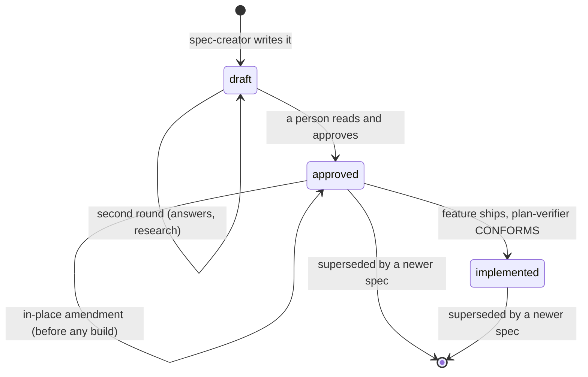

# Artifacts

Four kinds of file come out of the chain. One **stem** — `YYYY-MM-DD-short-name` — ties
a feature's spec, plan and run reports together.

| Artifact | Written by | Location | Committed? |
|---|---|---|---|
| Spec | `sdd-engineering:spec-creator`; `Status` by a person | `<specsDir>/<stem>.md` | yes |
| Plan | `sdd-engineering:implementation-planner` | `<plansDir>/<stem>.md` | yes, until the feature ships |
| Run reports | `/sdd-engineering:run-plan` and `sdd-engineering:plan-verifier` | `<runsDir>/<stem>/NN-*.md` | no — git-ignored |
| Retro entry | `/sdd-engineering:workflow-retro` | `<retroDir>/ledger/YYYY-MM-DD-<stem-or-title>.md` | yes |

Defaults: `specsDir` = `specs/`, `plansDir` = `plans/`, `runsDir` = `.sdd/runs/`,
`retroDir` = `docs/retro/`. See [configuration.md](configuration.md).

## Spec

**What and why** — never how. A dated markdown file with a fixed header and eleven
sections:

```
# Spec: <feature>
Spec ID: SPEC-YYYY-MM-DD-short-name
Status: draft | approved | implemented
Supersedes: SPEC-<yyyy-mm-dd>-<other-name> | none
Packages: <those touched>

## Problem and user             who is blocked, on what, what they do instead; Request vs tree
## Goals / Non-goals            observable outcomes; what is deliberately out
## User stories                 US-n: As a <role>, I want <…> so that <…>
## Acceptance criteria (EARS)   AC-n, one EARS pattern each, checkable · traces · verify
## Edge cases                   EC-n, EARS "IF … THEN" form · traces · verify
## Design review                DR-n: Gaps · Uncovered cases · Module interactions · UX improvements
## Non-functional requirements  NFR-n: latency, caps, i18n, a11y, degraded mode, cost · verify
## Traceability                 one row per AC / EC / NFR: traces to · verify how
## Inputs and provenance        request · answers · research · design · repo · insights
## Untrusted inputs             runtime inputs only: Input · Source · Validation · On invalid
## Open questions               Q-n (blocking | non-blocking), never silently empty
```

- **Naming:** `YYYY-MM-DD-short-name.md` — the date the spec was started and two to four
  lowercase words naming the feature. **Spec ID** = `SPEC-` + the stem. A stem is never
  reused.
- **EARS:** every acceptance criterion and edge case uses one of five patterns —
  *The system shall …*, *WHEN …*, *WHILE …*, *IF … THEN …*, *WHERE …* — with `shall`, a
  `traces:` (`US-n` or `DR-n`) and a `verify:` lane (`unit | component | integration |
  e2e | static | manual`).
- **Lint:** `spec-creator` runs the `spec-writing` skill's `spec-lint.mjs` on every spec
  it writes; a CRITICAL (filename ↔ Spec ID, `Status`) must be fixed.
- **Designs:** PNGs or markdown mockups under `<specsDir>/designs/<slug>/`, passed by path.

### `Status` lifecycle



- Only a person moves `Status`. An agent only ever writes `draft`.
- `/sdd-engineering:run-plan` refuses a plan whose spec is still `draft`.
- **Supersedes:** once building has started, a changed decision is a **new** spec, dated
  the day it is written, with `Supersedes: SPEC-<old stem>`. The planner plans against the
  newest spec in the chain.
- **Amend in place** instead when all three hold: the person asked for the change,
  `<runsDir>/<stem>/` holds no `1x-build*` report, and no commit after the plan touches
  code. The `Status` stays; a dated *Resolved decisions* line and an `answers` provenance
  row record it.

Full detail: the `spec-writing` skill and its `references/` files.

## Plan

**How** — numbered steps another agent executes. Same stem as the spec:
`specs/2026-10-15-export-invoice-pdf.md` → `plans/2026-10-15-export-invoice-pdf.md`.

The header carries three fields `/sdd-engineering:run-plan` parses, spelled exactly:

```
**Plan ID:** <stem>  ·  **Spec:** [<specsDir>/<stem>.md](<specsDir>/<stem>.md) or "none"  ·
**Execution mode:** single-agent | multi-agent  ·  **Packages:** <…>  ·
**Assumptions:** <or "none">
```

Then: Summary · Requirements review (the ledger, statuses `clear`, `ambiguous`,
`contradicts tree`, `contradicts conventions`) · Context read · Lessons that bind this
work · Constraints · **Skill contract** (file group → namespaced write-time skills) ·
Tracks (multi-agent only, exclusive file ownership) · **Steps** (files `new`/`edit`,
layer, skills, do, *Done when*, *Verify*) · Test plan · Risks & rollback · Out of scope ·
Open questions (`- **Blocking:** …` stops a run).

- The planner writes the file itself and returns a short *Plan Report*; agents are handed
  the path, never a retelling.
- An existing plan with the same stem is never overwritten.
- Delete the plan or move it to `<plansDir>/done/` once the feature ships.

Full template: `skills/run-plan/references/plan-format.md`.

## Run reports

One folder per plan, `<runsDir>/<stem>/`, one file per agent run, numbered by phase so
the listing is the run's history:

| File | Phase | Written by |
|---|---|---|
| `10-build.md` | build, single-agent | run-plan (implementer's report, verbatim) |
| `10-build-step0.md`, `11-build-track-<X>.md`, `12-build-integration.md` | build, multi-agent | run-plan |
| `20-verify-1.md` | verify, pass 1 | plan-verifier itself |
| `21-fix-<i>.md` | verify fix loop, `i` ≤ 2 | run-plan |
| `22-verify-<i+1>.md` | verify delta after fix `i` | plan-verifier itself |
| `30-arch-<i>.md` | architecture review, `i` ≤ 3 | run-plan |
| `31-arch-fix-<i>.md` | arch fix loop, `i` ≤ 2 | run-plan |
| `40-verify-delta.md` | delta verification | plan-verifier itself |
| `41-fix.md`, `42-verify-delta-2.md` | the one delta fix | run-plan / plan-verifier |
| `70-gate-1.md`, `71-gate-fix.md`, `72-gate-2.md` | gate, when configured | run-plan |
| `summary.md` | end of every run, DONE or STOPPED | run-plan |

- Reports are saved **verbatim**, before the orchestrator reads them for a verdict.
- Each report's verdict is on a header line: `**Status:** DONE | PARTIAL | BLOCKED`
  (implementer), `**Verdict:** CONFORMS | PARTIAL | DIVERGES` (plan-verifier),
  `**Verdict:** CLEAN | CONCERNS | BLOCKING-RISK` with numbered `CRITICAL | WARNING |
  SUGGESTION` findings (architecture-reviewer).
- **Resume:** without `--from`, the highest-numbered report decides where the next run
  starts (`1x` → verify, `2x` → arch, `3x` → delta, `40`–`42` → gate, `70`+ → gate
  again). A plan changed after the last report restarts from build.
- The folder is local state. Ignore it in git (see [configuration.md](configuration.md));
  a fresh clone or worktree simply starts from build.

## Retro ledger

`/sdd-engineering:workflow-retro` writes one entry per run and keeps an index:

- **Entry:** `<retroDir>/ledger/YYYY-MM-DD-<stem-or-title>.md` — Numbers · Agent timeline
  · Per agent (input, hard, easy, duplicated, missed, report) · Cross-cutting findings ·
  Proposals · Earlier proposals · Impressions · Not measured. A second entry for the same
  stem gets a `-2` suffix.
- **Index:** a table in `<retroDir>/README.md`, newest first. The skill creates the README
  from its template when it is missing.
- **Lifecycle of a proposal:** `open` until a later retro marks it `adopted` (the target
  changed and matches) or `declined` (the person said so). Three retros with the same
  proposal open is itself a finding.
- The retro edits nothing outside `<retroDir>`; proposals are adopted by hand, in their
  own change.

Templates: `skills/workflow-retro/references/ledger-template.md`.
